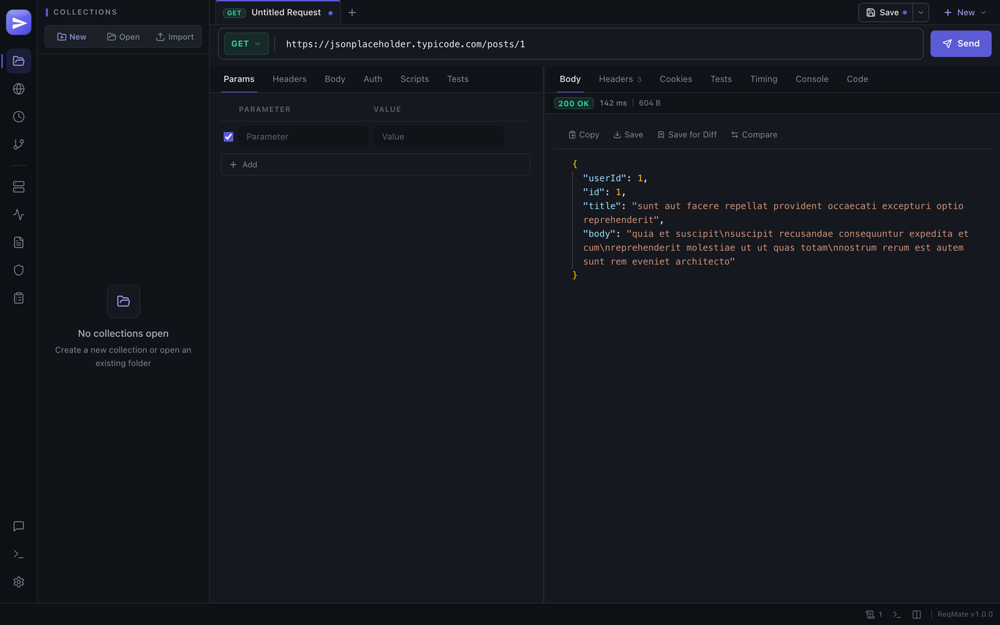
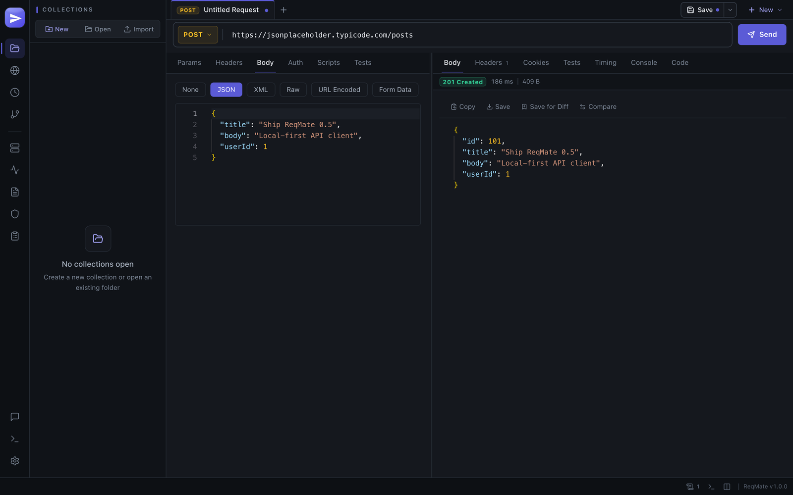
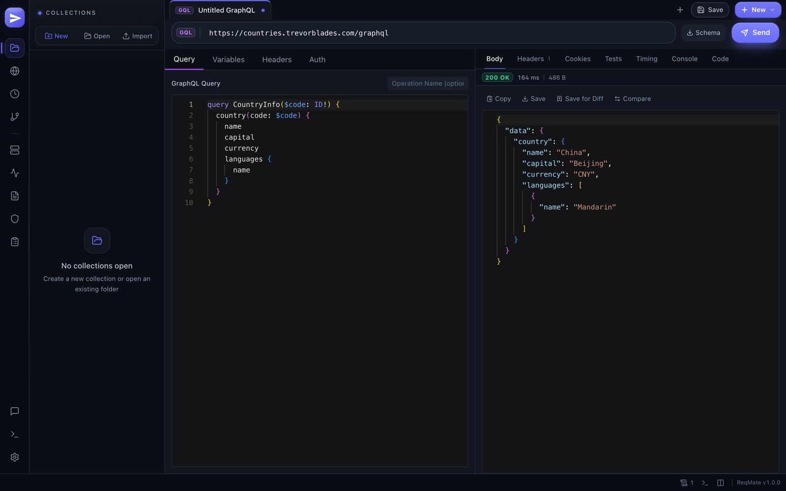
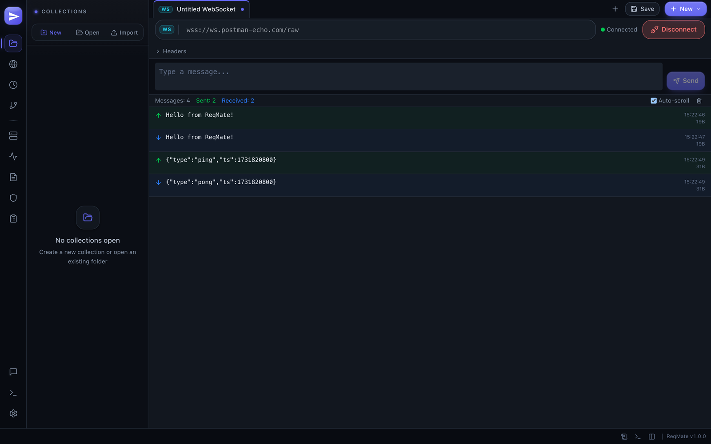
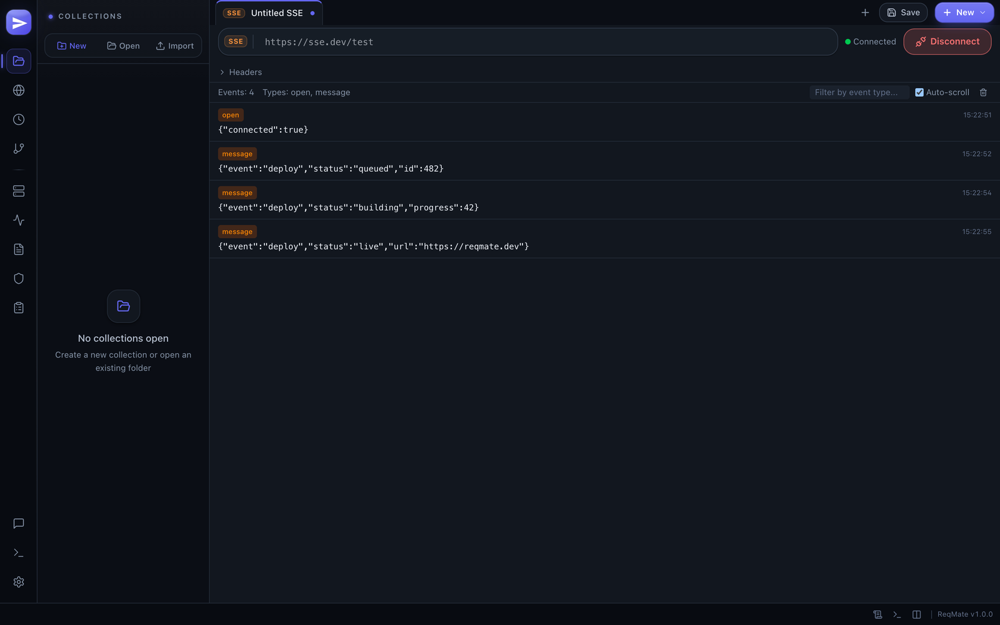
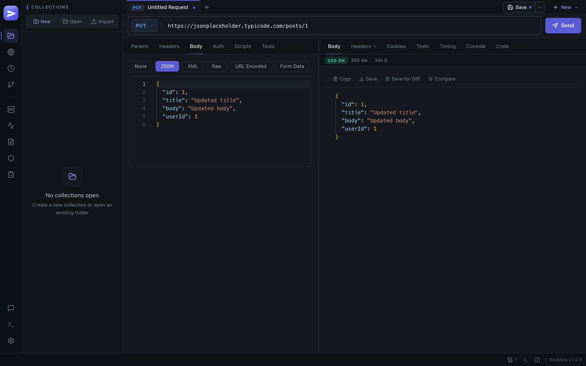
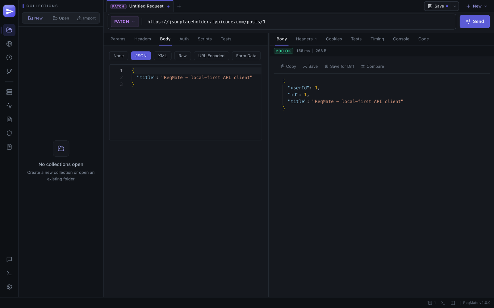
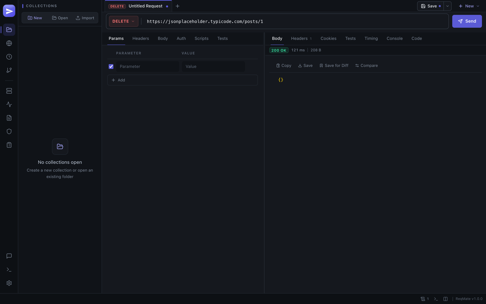

<p align="center">
  
</p>

<h1 align="center">ReqMate</h1>

<p align="center">
  <strong>The API platform that respects your privacy, your RAM, and your Git workflow.</strong>
</p>

<p align="center">
  No login. No cloud. No bloat.
</p>

<p align="center">
  <em>Postman uses 800 MB of RAM. ReqMate uses 60 MB.</em>
</p>

<p align="center">
  <a href="https://github.com/anan2620/ReqMate/releases/latest"></a>
  <a href="https://github.com/anan2620/ReqMate/releases/latest"></a>
  <a href="https://github.com/anan2620/ReqMate/stargazers"></a>
  <a href="https://github.com/anan2620/ReqMate/actions/workflows/ci.yml"></a>
  <a href="LICENSE"></a>
</p>

<p align="center">
  <a href="#download">Download</a> &bull;
  <a href="#features">Features</a> &bull;
  <a href="#switching-from-postman">Switching from Postman</a> &bull;
  <a href="#performance">Performance</a> &bull;
  <a href="#community">Community</a> &bull;
  <a href="#development">Development</a>
</p>

<p align="center">
  <a href="README.md">English</a> &bull;
  <a href="docs/readme/README_es.md">Espa&#241;ol</a> &bull;
  <a href="docs/readme/README_fr.md">Fran&#231;ais</a> &bull;
  <a href="docs/readme/README_de.md">Deutsch</a> &bull;
  <a href="docs/readme/README_pt.md">Portugu&#234;s</a> &bull;
  <a href="docs/readme/README_zh.md">&#20013;&#25991;</a> &bull;
  <a href="docs/readme/README_ja.md">&#26085;&#26412;&#35486;</a> &bull;
  <a href="docs/readme/README_ko.md">&#54620;&#44397;&#50612;</a> &bull;
  <a href="docs/readme/README_ar.md">&#1575;&#1604;&#1593;&#1585;&#1576;&#1610;&#1577;</a>
</p>

<p align="center">
  
</p>

<details>
<summary><strong>More screenshots</strong></summary>

<table>
<tr>
<td><strong>POST Request</strong></td>
<td><strong>GraphQL</strong></td>
</tr>
<tr>
<td></td>
<td></td>
</tr>
<tr>
<td><strong>WebSocket</strong></td>
<td><strong>Server-Sent Events</strong></td>
</tr>
<tr>
<td></td>
<td></td>
</tr>
<tr>
<td><strong>PUT Request</strong></td>
<td><strong>PATCH Request</strong></td>
</tr>
<tr>
<td></td>
<td></td>
</tr>
<tr>
<td><strong>DELETE Request</strong></td>
<td></td>
</tr>
<tr>
<td></td>
<td></td>
</tr>
</table>

</details>

## Download

**[Latest Release](https://github.com/anan2620/ReqMate/releases/latest)**

| Platform    | Download                                                                                                                                                                                                     |
| ----------- | ------------------------------------------------------------------------------------------------------------------------------------------------------------------------------------------------------------ |
| **Windows** | [`.exe` installer](https://github.com/anan2620/ReqMate/releases/latest) &bull; [`.msi`](https://github.com/anan2620/ReqMate/releases/latest)                                                                 |
| **macOS**   | [Apple Silicon `.dmg`](https://github.com/anan2620/ReqMate/releases/latest) &bull; [Intel `.dmg`](https://github.com/anan2620/ReqMate/releases/latest)                                                       |
| **Linux**   | [`.AppImage`](https://github.com/anan2620/ReqMate/releases/latest) &bull; [`.deb`](https://github.com/anan2620/ReqMate/releases/latest) &bull; [`.rpm`](https://github.com/anan2620/ReqMate/releases/latest) |

<details>
<summary><strong>Package managers</strong></summary>

```bash
# Homebrew (macOS)
brew tap anan2620/ReqMate
brew install --cask reqmate

# Scoop (Windows)
scoop bucket add reqmate https://github.com/anan2620/ReqMate
scoop install reqmate

# APT (Debian/Ubuntu)
curl -fsSL https://anan2620.github.io/reqmate-apt/install.sh | sudo bash
sudo apt install reqmate
```

Also available on the [Microsoft Store](https://apps.microsoft.com/search?query=ReqMate).

</details>

<details>
<summary><strong>Build from source</strong></summary>

**Prerequisites:** Node.js 22+, pnpm 10+, Rust toolchain, [Tauri v2 system deps](https://v2.tauri.app/start/prerequisites/)

```bash
git clone https://github.com/anan2620/ReqMate.git
cd reqmate
pnpm install
pnpm tauri build
```

</details>

## Switching from Postman

1. Export your Postman collection (Collection v2.1 JSON)
2. Open ReqMate
3. `Ctrl+K` > "Import Collection" > select your file
4. Done. Your requests are now YAML files you own.

Also imports from: **Insomnia**, **Bruno**, **Hoppscotch**, **OpenAPI 3.x**, **HAR**, **cURL**.

## Features

**Multi-Protocol** — REST, GraphQL, gRPC, WebSocket, SSE, MQTT, Socket.IO in one app. No tool has broader protocol coverage.

**Local-First Storage** — Every request is a `.yaml` file. Collections are directories. Everything is git-diffable. No proprietary formats.

**Dark Mode + Themes** — Dark, Light, Black/OLED themes with 8 accent colors.

**TypeScript Scripting** — Pre/post-request scripts with full type definitions. `req.test()`, `req.expect()`, `req.env.set()`.

**Collection Runner** — Run entire collections with data-driven testing (CSV/JSON), configurable iterations, JUnit/HTML reports.

**Local Mock Servers** — Create mock APIs from your collections. Faker.js data, latency simulation, error injection. No cloud, no usage limits.

**Scheduled Monitoring** — Cron-based automated testing with desktop notifications and webhook alerts. Runs locally, not on someone else's server.

**API Docs Generation** — Generate HTML + Markdown documentation from your collections.

**OpenAPI Editor** — Edit and lint OpenAPI specs with Spectral integration.

**Response Diff** — Compare responses side-by-side across runs.

**Proxy Capture** — Local intercepting HTTP/HTTPS proxy for traffic inspection and replay.

**AI Assistant** — Natural language to requests, auto-generate tests, OpenAI-compatible API.

**Plugin System** — Extend ReqMate with JavaScript or WASM plugins. WASM plugins run sandboxed and fuel-metered, with no filesystem or network access. See [`docs/plugins.md`](docs/plugins.md) for the ABI.

**Import Everything** — Postman, Insomnia, Bruno, Hoppscotch, OpenAPI, HAR, cURL. One-click migration.

## Performance

Built with Tauri v2 (Rust backend + native OS webview), not Electron.

| Metric               | Target         |
| -------------------- | -------------- |
| Binary size          | ~20 MB         |
| RAM at idle          | ~60 MB         |
| Cold startup         | <2s            |
| Request send latency | <10ms overhead |

## Data Format

Your data is plain YAML. No lock-in. No proprietary encoding.

```yaml
# users/create-user.yaml
name: Create User
method: POST
url: "{{baseUrl}}/api/users"

headers:
  Content-Type: application/json

auth:
  type: bearer
  token: "{{adminToken}}"

body:
  type: json
  content: |
    {
      "name": "{{userName}}",
      "email": "{{userEmail}}"
    }

assert:
  status: 201
  body.id: { type: string }
  responseTime: { lt: 2000 }

tests: |
  req.test("should return created user", () => {
    const body = req.response.json();
    req.expect(body).to.have.property("id");
  });
```

## CLI

```bash
# Run a collection
reqmate run ./my-collection --env production

# With data-driven testing
reqmate run ./my-collection --data users.csv --reporter junit

# Import a Postman collection
reqmate import postman-export.json
```

## No Lock-In Pledge

> If you decide to leave ReqMate, your data leaves with you. Every file is a standard format. Every database is open. We will never make it hard to switch away.

## Community

- [GitHub Discussions](https://github.com/anan2620/ReqMate/discussions) — Ideas, Q&A, show & tell
- [GitHub Issues](https://github.com/anan2620/ReqMate/issues) — Bug reports and feature requests

## Translations

ReqMate UI supports internationalization via `react-i18next`, with shipped translations in
**English**, **Español**, **Français**, **Deutsch**, **Português**, **中文**, **日本語**, **한국어**, and **العربية**.

Pick your language in Settings > Appearance. Missing strings fall back to English.

Help us improve a translation! See the [`locales/`](apps/desktop/src/locales/) directory and submit a PR.

## Development

```bash
# Install dependencies
pnpm install

# Run in development mode
pnpm tauri dev

# TypeScript check
pnpm -C apps/desktop exec tsc --noEmit

# Guard rails (also run in CI): version consistency + Rust↔TS model drift
pnpm check:versions
pnpm check:models

# Build for production
pnpm tauri build
```

### Project Structure

```
reqmate/
├── apps/
│   ├── desktop/           # Tauri v2 desktop app
│   │   ├── src/           # React frontend
│   │   └── src-tauri/     # Rust backend
│   ├── cli/               # CLI tool (Rust)
│   ├── mcp-server/        # MCP server for AI editors
│   └── vscode-extension/  # VS Code extension
├── packages/
│   ├── types/             # Shared TypeScript types
│   └── importer/          # Collection importers
└── docs/                  # Documentation and legal
```

### Tech Stack

**Frontend:** React 19, TypeScript, Vite 6, Zustand, Tailwind CSS 4, Monaco Editor, Radix UI

**Backend:** Rust, Tauri v2, reqwest, tokio, tonic (gRPC), axum (mock servers), rquickjs (scripting sandbox)

## Contributing

Contributions are welcome! Check out the [GitHub Issues](https://github.com/anan2620/ReqMate/issues) for open tasks and feature requests.

<a href="https://github.com/anan2620/ReqMate/graphs/contributors">
  
</a>

## Acknowledgements

This project is a modified version of **[ApiArk](https://github.com/berbicanes/apiark)**, created
and maintained by **[Anes Berbic (@berbicanes)](https://github.com/berbicanes)**. It has been
renamed to **ReqMate** so that the two projects are not confused with each other.

Sincere thanks to **Anes Berbic** for designing and open-sourcing ApiArk, and to everyone who has
contributed to it upstream — this work would not exist without them.

- Upstream repository: <https://github.com/berbicanes/apiark>
- Upstream license: MIT — see [LICENSE](LICENSE), which keeps the upstream copyright notice
  alongside ReqMate's own

## License

[MIT](LICENSE)

---

<p align="center">
  <sub>If ReqMate helps your workflow, consider giving it a star. It helps others discover the project.</sub>
</p>
